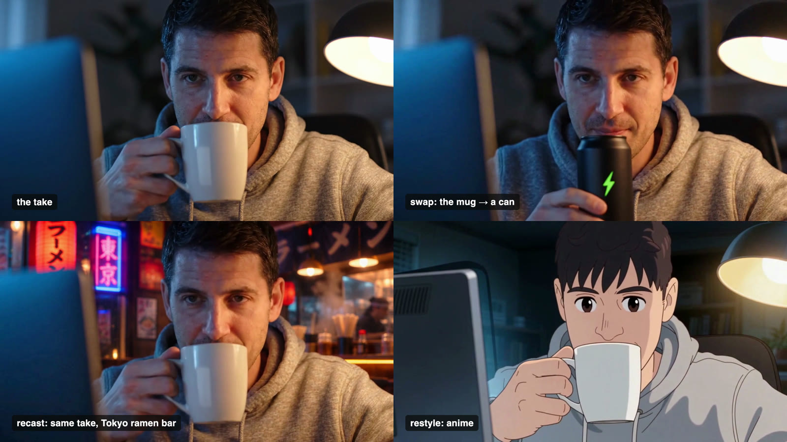

# recast

A Claude skill that changes one thing in a video and keeps the rest of the shot. It runs on the [Darkwoods](https://darkwoods.ai) API.

- **Swap** a product, prop, sign or outfit. The person, light and camera stay the same.
- **Recast** who or where. The performance, lip sync and camera move stay the take's own.
- **Restyle** the whole shot: anime, 3D, stop motion. Motion and framing stay.



Every edit starts as a cheap 480p draft. It's checked against the take for jumps, drift, frozen frames and edits that changed nothing before you pay for the full render. Then the take's own sound goes back on, so lips and steps stay in sync.

## Install

```bash
git clone https://github.com/500bitcoins/recast ~/.claude/skills/recast
export DARKWOODS_API_KEY=dwk_...        # your Darkwoods API key
```

Needs Node 22+ and ffmpeg. Google Chrome is optional, only for the labels on reels. There's nothing to `npm install`.

Then ask Claude in plain words:

> recast this clip: swap the mug for the can in can.png, then make a version in a Tokyo ramen bar and one in anime

## What it does

1. **Probe and prep** (`prep.mjs`): reads the length, frame rate, size and sound. It cuts the take into parts of at most 10 s and under 10 MB, which is what the edit models take.
2. **Target frame** (`target.mjs`): the take's real first frame with only the change made, using an image model and your reference pictures. It's the strongest steer the video model gets.
3. **480p draft** (`edit.mjs`): `seedance-2.5-edit` by default, with `genjutsu-restyle`, `genjutsu-object-swap` and `kling-o3-edit` as options. It prints the price and renders nothing until you say yes.
4. **Check** (`check.mjs`): scores the draft against the take, then makes a contact sheet so you can look at hands, faces, brand marks and text.

   | Check | Fails when |
   |---|---|
   | length | more than 5% off the take |
   | how much changed | under 1.5% of the frame: the edit did nothing |
   | structure kept | the layout and edges are lost |
   | motion match | the render doesn't move when the take does |
   | jumps | a pose resets or morphs between frames |
   | tail drift | the last frames wander (it suggests a trim point) |
   | frozen frames | it stalls while the take moves |

5. **Finals** (`edit.mjs --res 720p|1080p`): only the drafts that pass are rendered at full resolution.
6. **Finish** (`finish.mjs`): restores the take's sound, lines every version up with the take frame for frame, and joins the parts.
7. **Reel** (`reel.mjs`): the take, then each version, labelled, ready to post.

## What it costs

These are Darkwoods credits for an 8 s clip, as quoted on 2026-10-24:

| Model | 480p draft | 720p final |
|---|---|---|
| `seedance-2.5-edit` | 246 | 533 |
| `genjutsu-restyle` | — | 463 |
| `kling-o3-edit` | — | 86 |

A target frame is about 2–7 credits. The check runs locally and costs nothing.

MIT licence.
